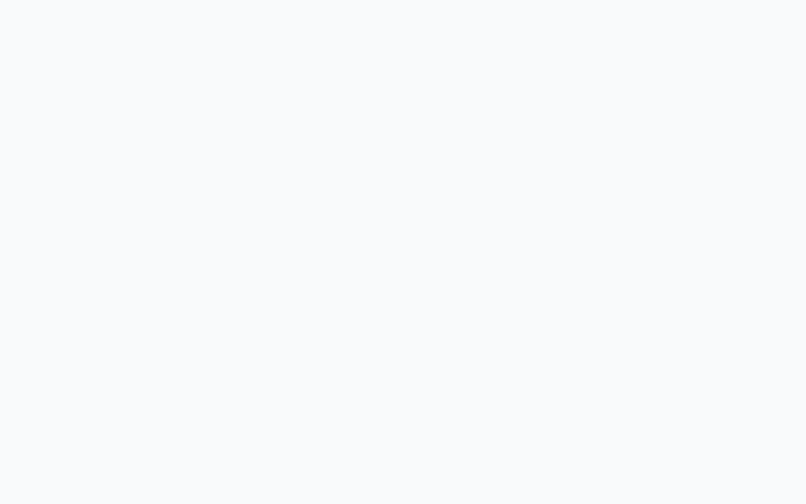
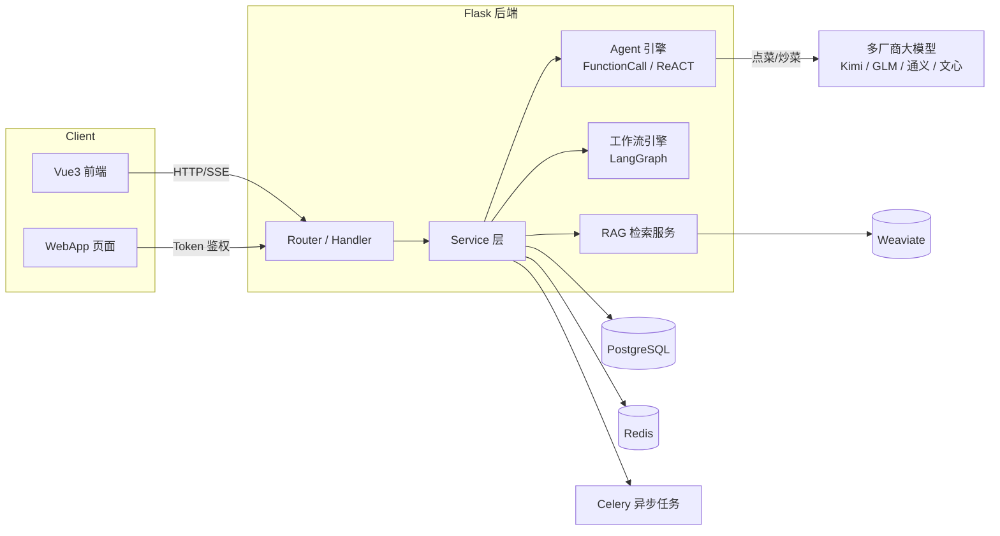

# 慕课 LLMOps AppBuilder

一个从零开发的 LLMOps 平台：把大模型、知识库、工具、工作流编排成可发布、可对话的 AI 原生应用。类似 Dify / Coze 的产品形态，涵盖智能体、RAG 检索增强、可视化工作流、应用发布与 WebApp 对话的完整闭环。



## ✨ 功能特性

| 模块 | 说明 | 关键技术 |
|---|---|---|
| 🤖 智能体应用 | FunctionCall / ReACT 双引擎，多轮对话、长期记忆、敏感词审核 | LangChain Agent + LangGraph |
| 📚 知识库（RAG） | 文档上传解析、分段、向量化、语义/全文/混合检索 | Weaviate + Embedding 模型 |
| 🧩 可视化工作流 | 画布拖拽编排 8 类节点（LLM/代码/HTTP/模板/工具等），草稿校验、调试、发布为工具 | LangGraph StateGraph 编译执行 |
| 🔧 工具体系 | 内置插件（搜索/天气等）、自定义 API 工具、工作流即工具 | 插件式 Provider Manager |
| 🚀 应用发布 | 调试通过门禁 → 发布生成 WebApp 凭证，历史版本管理与回滚 | 多版本 AppConfig |
| 💬 WebApp 对话 | 面向终端用户的聊天页面：会话管理、置顶/重命名、建议问题、停止响应 | SSE 流式推送 |
| 🌐 OpenAPI | API 调用形式开放应用对话能力 | SSE + API Key 鉴权 |
| 📊 应用统计 | 对话量、Token 消耗、延迟等运营数据 | SQLAlchemy 聚合查询 |
| 🧠 辅助智能体 | 平台内置助手，支持长期记忆召回 | FAISS 向量记忆 |

## 🏗️ 架构总览



**核心理念**：声明式与命令式分离——画布上的 JSON 图数据是"声明"，`Workflow(BaseTool)` 把它编译成 LangGraph 可执行状态机，再适配成 LangChain 工具，让 Agent 能像调用搜索一样调用整张工作流（详见 [docs/workflow_tool_design_notes.md](docs/workflow_tool_design_notes.md)）。

## 🛠️ 技术栈

**后端**：Python 3.10 · Flask · SQLAlchemy + PostgreSQL · LangChain / LangGraph · Weaviate · Redis · Celery · injector 依赖注入

**前端**：Vue 3 · TypeScript · Vite · Arco Design · vue-flow（画布）· TailwindCSS

**模型支持**：Moonshot Kimi、智谱 GLM、OpenAI、通义千问、文心一言（yaml 声明式接入，新模型加一个目录即可）

## 📂 项目结构

```
llmops-api/
├── app/                 # 应用入口（Http 引擎组装、依赖注入）
├── config/              # 配置类
├── internal/
│   ├── core/            # 核心引擎：agent / workflow / language_model / tool / memory
│   ├── handler/         # 控制器层
│   ├── service/         # 业务逻辑层
│   ├── schema/          # 请求/响应结构校验
│   ├── model/           # SQLAlchemy ORM 模型
│   ├── router/          # 路由注册
│   ├── entity/          # 领域实体与枚举
│   └── extension/       # Redis / Celery / 日志等扩展
├── pkg/                 # 通用组件（SQLAlchemy、分页器、统一响应）
├── docs/                # 设计笔记与学习文档
└── storage/             # 日志等运行时文件
```

## 🚀 快速启动

### 后端

```bash
# 1. 创建虚拟环境并安装依赖
python -m venv env
env\Scripts\activate            # Windows
pip install -r requirements.txt

# 2. 准备 .env（参考下方环境变量）

# 3. 初始化数据库表
flask db upgrade

# 4. 启动服务（默认 5000 端口）
flask run
```

### 前端

```bash
yarn install
yarn dev        # 启动在 5173 端口，直连后端 5000
```

### 环境变量（.env）

| 变量 | 说明 |
|---|---|
| `SQLALCHEMY_DATABASE_URI` | PostgreSQL 连接串 |
| `REDIS_HOST` / `REDIS_PORT` | Redis（队列与 Celery） |
| `WEAVIATE_URL` | 向量数据库地址 |
| `MOONSHOT_API_KEY` / `ZHIPU_API_KEY` / `OPENAI_API_KEY` 等 | 各厂商模型密钥 |
| `SERPER_API_KEY` / `GAODE_API_KEY` | 内置工具密钥 |

## 📖 深入学习笔记

开发过程中沉淀的设计文档，覆盖本项目最核心的几层抽象：

- [工作流引擎设计思想：编译器 + 适配器](docs/workflow_tool_design_notes.md)
- [一个对象成为 LangChain Tool 的四要素](docs/tool_four_elements_notes.md)
- [LangGraph 核心概念：State / Node / Edge / Superstep](docs/langgraph_core_concepts_notes.md)
- [Agent 核心模块](docs/agent_core_module_notes.md)
- [辅助智能体会话脱节 Bug 复盘](docs/assistant_agent_conversation_detached_bug_notes.md)
- [Token 计数与编码器](docs/token_counting_encoding_override_notes.md)
- [BaseTool 包装设计](docs/base_tool_wrapping_notes.md)

## 📌 开发进度

- [x] 账号与认证（含 GitHub OAuth）
- [x] 智能体应用：编排、调试、草稿配置
- [x] 知识库：文档、分段、检索
- [x] 内置插件与 API 工具
- [x] 工作流编排、调试、发布为工具
- [x] 应用发布与版本管理
- [x] WebApp 对话（会话管理、SSE 流式、停止响应）
- [x] 辅助智能体（长期记忆）
- [ ] 语音转文字 / 文字转语音
- [ ] 应用统计分析完善
- [ ] 生产化部署（gunicorn + nginx + systemd）

---

> 本项目为慕课网 LLMOps 课程的实践产出，欢迎交流学习。
